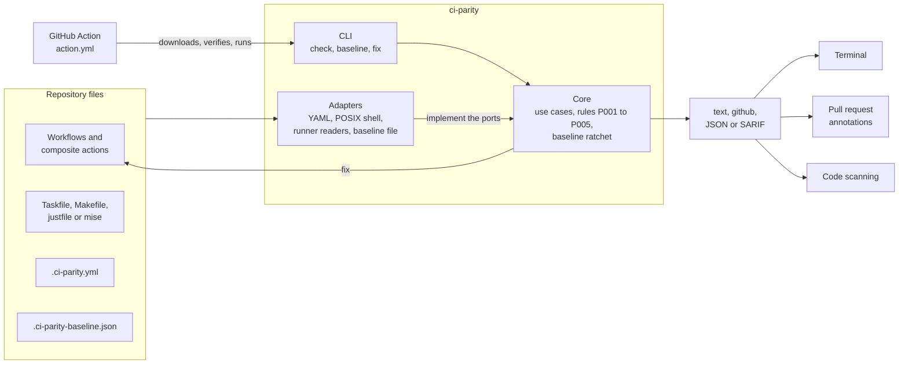

<!-- Copyright (c) 2026 Jimmy Kurian. Licensed under Apache-2.0; see LICENSE. SPDX-License-Identifier: Apache-2.0 -->

<h1>
  <picture>
    <source media="(prefers-color-scheme: dark)" srcset="docs/assets/logo-dark.svg">
    
  </picture>
</h1>

ci-parity checks that GitHub Actions workflows invoke project commands through the
repository's task runner instead of calling build, test, lint and deploy tools inline.
It reports every inline invocation, verifies that every task CI references exists, and
keeps a per-workflow baseline so an existing repo can migrate one workflow at a time
without regressing.

[](https://github.com/jimmykurian/ci-parity/releases/latest) [](LICENSE)

[Documentation](https://ci-parity.is-a.dev/) · [Why ci-parity](https://ci-parity.is-a.dev/guides/why/) · [GitHub Marketplace](https://github.com/marketplace/actions/ci-parity) · [Changelog](https://ci-parity.is-a.dev/changelog/)



## Install

```yaml
- uses: actions/checkout@v7
- uses: jimmykurian/ci-parity@v0
```

Or as a binary, with `go install`, mise, or a pre-commit hook:
[Getting started](https://ci-parity.is-a.dev/guides/getting-started/).

Until v1.0.0, a minor release may change commands, config keys and output; rule IDs, the
baseline format and the JSON schema change only with a new `version` in the file.

## Quick start

On a workflow that calls tools directly, next to a Taskfile that already wraps them:

```text
$ ci-parity check
.github/workflows/ci.yml
  9:14    P001 inline-tool   step "Install" in job "test" runs 'pnpm install --frozen-lockfile' directly; already available as 'task install'
  11:14   P001 inline-tool   step "Test" in job "test" runs 'pnpm test' directly; already available as 'task test'
  13:19   P002 unknown-task  'task lint' is not defined in Taskfile.yml (closest: test)

3 errors, 0 warnings, 0 tolerated, 0 allowed
```

`ci-parity fix` rewrites the steps it safely can, and `ci-parity baseline` lets an
existing repository adopt it one workflow at a time.

How it compares with actionlint, zizmor and other workflow linters, and why it lints
rather than generates workflows: [Why ci-parity](https://ci-parity.is-a.dev/guides/why/).

## Documentation

The full documentation is at **<https://ci-parity.is-a.dev/>**, with search. It's built from
[`docs/`](docs/README.md), so every page also reads here on GitHub.

| | |
| --- | --- |
| [Guides](https://ci-parity.is-a.dev/guides/) | [Getting started](https://ci-parity.is-a.dev/guides/getting-started/), [configuring](https://ci-parity.is-a.dev/guides/configuring/), [adopting with a baseline](https://ci-parity.is-a.dev/guides/baseline/), [fixing findings](https://ci-parity.is-a.dev/guides/fixing/), [CI setup](https://ci-parity.is-a.dev/guides/ci/), [recipes](https://ci-parity.is-a.dev/guides/recipes/) and the [FAQ](https://ci-parity.is-a.dev/guides/faq/) |
| [Rules](https://ci-parity.is-a.dev/rules/) | [P001](https://ci-parity.is-a.dev/rules/p001/) to [P005](https://ci-parity.is-a.dev/rules/p005/): what each catches, an example, and how to fix or allow it |
| [Reference](https://ci-parity.is-a.dev/reference/) | Configuration, the baseline, the CLI and exit codes, the output formats, the GitHub Action, and what stays [compatible](https://ci-parity.is-a.dev/reference/compatibility/) between releases |
| [Architecture](https://ci-parity.is-a.dev/architecture/) | Packages and ports, flows, and design decisions |
| [Changelog](https://ci-parity.is-a.dev/changelog/) | Every release |

## Architecture

ci-parity reads the repository's files, never runs them, and reports through one of four
formats. The core (rules and use cases) depends only on ports; each file format, shell,
runner and output is an adapter behind one.



[docs/architecture/](docs/architecture/README.md) has the package layers, the ports, the
check, fix and release flows, and the design decisions.

## Development

Every command runs through the [Taskfile](Taskfile.yml); CI calls the same tasks.
`task ci` runs formatting, lint, tests, build and self-check. The linters and
formatters, from golangci-lint to typos, are pinned in [mise.toml](mise.toml) at the
versions CI uses; with [mise](https://mise.jdx.dev/), `mise install` sets them up.
`task hooks:install` turns on the pre-commit, commit-msg and pre-push hooks in
`.githooks/`. The devcontainer (`.devcontainer/`) sets all of this up in VS Code or
Codespaces.
See [CONTRIBUTING.md](CONTRIBUTING.md) for how to propose and test a change, and
[docs/](docs/README.md) for the full reference, the architecture and how releases work.

## Status

Each badge is a check from the last CI run on `main` (`.github/workflows/ci.yml` writes them to the `badges` branch). On a pull request, the same checks report in a comment on the PR.

### Checks

| Branch | Format | Lint | Workflows | Shell | YAML | Markdown | Spelling | EditorConfig | License headers | JSON Schemas | Code metrics | Release config |
| --- | --- | --- | --- | --- | --- | --- | --- | --- | --- | --- | --- | --- |
| main | [](https://github.com/jimmykurian/ci-parity/actions/workflows/ci.yml?query=branch%3Amain) | [](https://github.com/jimmykurian/ci-parity/actions/workflows/ci.yml?query=branch%3Amain) | [](https://github.com/jimmykurian/ci-parity/actions/workflows/ci.yml?query=branch%3Amain) | [](https://github.com/jimmykurian/ci-parity/actions/workflows/ci.yml?query=branch%3Amain) | [](https://github.com/jimmykurian/ci-parity/actions/workflows/ci.yml?query=branch%3Amain) | [](https://github.com/jimmykurian/ci-parity/actions/workflows/ci.yml?query=branch%3Amain) | [](https://github.com/jimmykurian/ci-parity/actions/workflows/ci.yml?query=branch%3Amain) | [](https://github.com/jimmykurian/ci-parity/actions/workflows/ci.yml?query=branch%3Amain) | [](https://github.com/jimmykurian/ci-parity/actions/workflows/ci.yml?query=branch%3Amain) | [](https://github.com/jimmykurian/ci-parity/actions/workflows/ci.yml?query=branch%3Amain) | [](https://github.com/jimmykurian/ci-parity/actions/workflows/ci.yml?query=branch%3Amain) | [](https://github.com/jimmykurian/ci-parity/actions/workflows/ci.yml?query=branch%3Amain) |

### Build and tests

| Branch | Unit tests | Integration tests | End-to-end tests | Build | Docs site | Self-check | macOS and Windows | Action download |
| --- | --- | --- | --- | --- | --- | --- | --- | --- |
| main | [](https://github.com/jimmykurian/ci-parity/actions/workflows/ci.yml?query=branch%3Amain) | [](https://github.com/jimmykurian/ci-parity/actions/workflows/ci.yml?query=branch%3Amain) | [](https://github.com/jimmykurian/ci-parity/actions/workflows/ci.yml?query=branch%3Amain) | [](https://github.com/jimmykurian/ci-parity/actions/workflows/ci.yml?query=branch%3Amain) | [](https://github.com/jimmykurian/ci-parity/actions/workflows/ci.yml?query=branch%3Amain) | [](https://github.com/jimmykurian/ci-parity/actions/workflows/ci.yml?query=branch%3Amain) | [](https://github.com/jimmykurian/ci-parity/actions/workflows/ci.yml?query=branch%3Amain) | [](https://github.com/jimmykurian/ci-parity/actions/workflows/ci.yml?query=branch%3Amain) |

### Security

| Branch | gitleaks | govulncheck |
| --- | --- | --- |
| main | [](https://github.com/jimmykurian/ci-parity/actions/workflows/ci.yml?query=branch%3Amain) | [](https://github.com/jimmykurian/ci-parity/actions/workflows/ci.yml?query=branch%3Amain) |

## Tech stack

| Go | Task | mise | golangci-lint | yaml.v3 | mvdan/sh | GitHub Actions |
| --- | --- | --- | --- | --- | --- | --- |
| [](https://go.dev/) | [](https://taskfile.dev/) | [](https://mise.jdx.dev/) | [](https://golangci-lint.run/) | [](https://github.com/go-yaml/yaml) | [](https://github.com/mvdan/sh) | [](https://github.com/jimmykurian/ci-parity/actions) |

## Code metrics

The size and complexity of the code: lines of code without blanks or comments
([scc](https://github.com/boyter/scc)), and the cyclomatic complexity of every Go
function. `task metrics:readme` writes them here, and CI fails while they're out of date,
so each change updates them. Run `task metrics` to see them locally.

<!-- METRICS:START -->

| Metric | Go code | Go tests | Docs site | Total |
| --- | --- | --- | --- | --- |
| Files | 62 | 33 | 6 | 101 |
| Lines of code | 4,827 | 3,045 | 443 | 8,315 |
| Functions | 267 | 146 | – | 413 |
| Average complexity | 4.7 | 3.3 | – | 4.2 |
| Max complexity | 18 | 16 | – | 18 |

<details>
<summary>The 10 most complex functions</summary>

| Function | Where | Complexity |
| --- | --- | --- |
| `(*extractor).peel` | `internal/adapters/shell/posix/extract.go:262` | 18 |
| `(*Justfile).read` | `internal/adapters/runner/justfile/justfile.go:83` | 17 |
| `(*Mise).Names` | `internal/adapters/runner/mise/names.go:31` | 17 |
| `TestRequiredFields` | `internal/adapters/report/sarif/sarif_test.go:38` | 16 |
| `(*parser).recipe` | `internal/adapters/runner/justfile/parse.go:100` | 16 |
| `(*Makefile).Names` | `internal/adapters/runner/makefile/names.go:37` | 16 |
| `(Source).Apply` | `internal/adapters/workflow/ghactions/edit.go:20` | 16 |
| `validate` | `internal/adapters/config/yamlconfig/config.go:87` | 15 |
| `Load` | `internal/adapters/workflow/ghactions/workflow.go:23` | 15 |
| `(*parser).line` | `internal/adapters/runner/justfile/parse.go:56` | 14 |

</details>

<!-- METRICS:END -->
