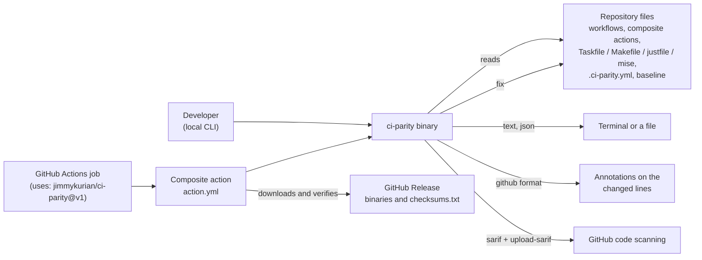

<!-- Copyright (c) 2026 Jimmy Kurian. Licensed under Apache-2.0; see LICENSE. SPDX-License-Identifier: Apache-2.0 -->

# Architecture

How ci-parity is put together: its context, its packages and ports, the main flows, and
the decisions behind them. Diagrams are Mermaid, which GitHub renders in place.

| Page | Shows |
| --- | --- |
| [System context](#system-context) | Who runs ci-parity, what it reads and where its results go |
| [Packages](packages.md) | The layers, their ports, and which adapter implements each |
| [Flows](flows.md) | A `check`, a `fix`, and a change from pull request to release |
| [Design decisions](decisions.md) | Why it works the way it does, and ideas not yet planned |

## System context

ci-parity reads only the repository's files. It never runs the task runner or the tools
it finds, and makes no network calls while checking; the action downloads the binary
before the check starts.

## See also

- [Documentation index](../README.md)
- [Reference](../reference/README.md)

Last reviewed: 2026-10-29
