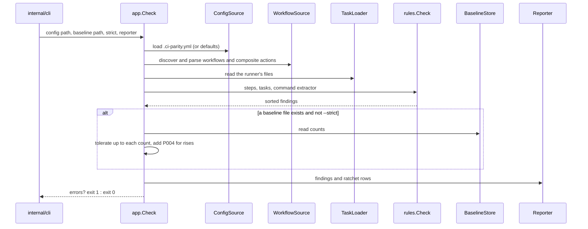
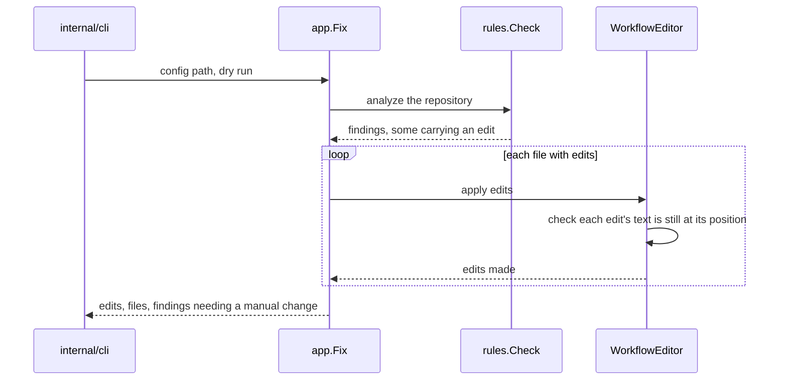
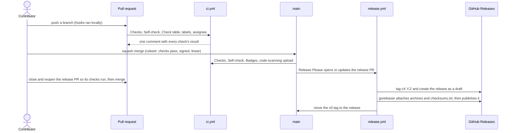

<!-- Copyright (c) 2026 Jimmy Kurian. Licensed under Apache-2.0; see LICENSE. SPDX-License-Identifier: Apache-2.0 -->

# Flows

What happens during a `check`, a `fix`, and a change on its way from a pull request to a
release.

## A check

`ci-parity check` builds the adapters for the repository at `-C`, then runs the check use
case (`internal/app/check.go`).

## A fix

`ci-parity fix` runs the same analysis, then rewrites the findings `rules` marked as safe
to change (`internal/app/fix.go`).

## From pull request to release

The Marketplace listing follows a release only after its edit page is saved with
"Publish this Action to the GitHub Marketplace" ticked.

## See also

- [Architecture](README.md)
- [Packages](packages.md)
- [Releases and CI](../deployment/releases-and-ci.md)

Last reviewed: 2026-10-28
