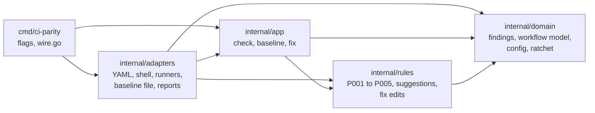

<!-- Copyright (c) 2026 Jimmy Kurian. Licensed under Apache-2.0; see LICENSE. SPDX-License-Identifier: Apache-2.0 -->

# Packages

The Go packages, the layers they form, and the ports that keep the core independent of
YAML, shells, runners and output formats.

## Layers

Dependencies point inward. `domain` imports only the standard library; `rules` imports
only `domain`; `app` imports `rules` and `domain`; adapters import inward layers; `cmd`
wires them together.

| Package | Holds |
| --- | --- |
| `internal/domain` | Findings and severities, the workflow model and script positions, extracted commands, the config value and its globs, the baseline ratchet, edits |
| `internal/rules` | The rules, suggestions (with package-runner unwrapping) and the edits `fix` can make |
| `internal/app` | The `check`, `baseline` and `fix` use cases |
| `internal/adapters` | Everything that touches a file format or the file system |
| `cmd/ci-parity` | Flag parsing, exit codes, and `wire.go`, which builds the adapters |

## Ports and adapters

Each port is an interface the inner layers own; an adapter implements it.

| Port | Defined in | Implemented by |
| --- | --- | --- |
| `TaskSource` | `internal/rules/ports.go` | `adapters/runner/taskfile`, `makefile`, `justfile`, `mise` |
| `CommandExtractor` | `internal/rules/ports.go` | `adapters/shell/posix` (bash and sh, with `mvdan.cc/sh/v3`) |
| `ConfigSource` | `internal/app/ports.go` | `adapters/config/yamlconfig` |
| `WorkflowSource` | `internal/app/ports.go` | `adapters/workflow/ghactions` |
| `WorkflowEditor` | `internal/app/ports.go` | `adapters/workflow/ghactions` (`edit.go`) |
| `TaskLoader` | `internal/app/ports.go` | `adapters/runner` (`loader.go` picks the runner's reader) |
| `BaselineStore` | `internal/app/ports.go` | `adapters/baseline/jsonfile` |
| `Reporter` | `internal/app/ports.go` | `adapters/report/text`, `github`, `json`, `sarif` |

Adding a runner, a shell or an output format means a new adapter; the rules and use
cases don't change.

## See also

- [Architecture](README.md)
- [Flows](flows.md)
- [Runners](../reference/runners.md)

Last reviewed: 2026-10-28
