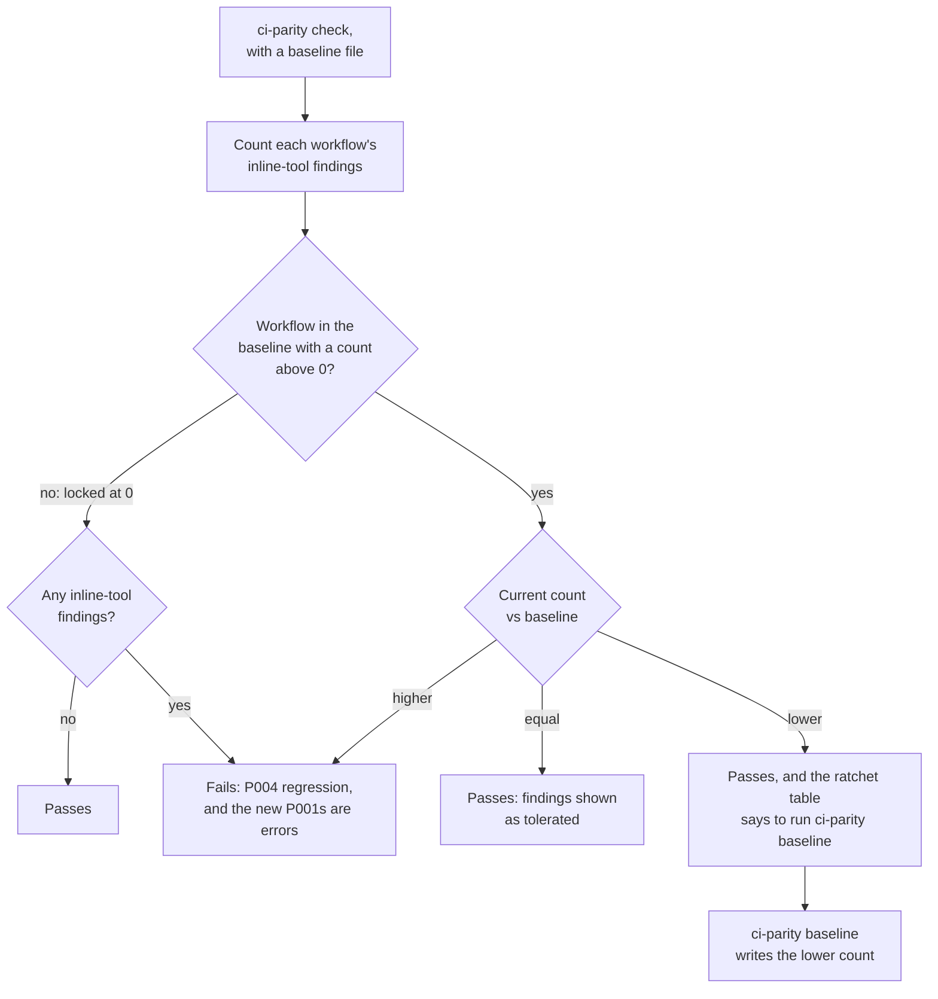

<!-- Copyright (c) 2026 Jimmy Kurian. Licensed under Apache-2.0; see LICENSE. SPDX-License-Identifier: Apache-2.0 -->

# Adopting with a baseline

Turn ci-parity on in a repository that already has inline steps, without fixing them all
first: record today's counts, then let them only go down.

## How the ratchet works

The baseline file, `.ci-parity-baseline.json`, holds one number per workflow: how many
[inline-tool findings](../rules/p001.md) it may still have. `check` tolerates that many
and fails on any more. When you remove inline steps, record the lower count and the
allowance shrinks for good.



## Step by step

1. Record today's counts, and commit the file:

   ```text
   $ ci-parity baseline
   wrote .ci-parity-baseline.json: 1 workflow, 3 inline-tool findings
   ```

   ```json
   {
     "version": 1,
     "workflows": {
       ".github/workflows/ci.yml": 3
     }
   }
   ```

   `check` now passes, with every existing finding tolerated:

   ```text
   $ ci-parity check
   0 errors, 0 warnings, 3 tolerated, 0 allowed
   ```

2. Replace inline steps with tasks, by hand or with [`ci-parity fix`](fixing.md). When a
   count drops, `check` says so:

   ```text
   $ ci-parity check
   ratchet
     .github/workflows/ci.yml  baseline 3   now 2   run `ci-parity baseline` to lock in

   0 errors, 0 warnings, 2 tolerated, 0 allowed
   ```

3. Lock in the lower count and commit it:

   ```text
   $ ci-parity baseline
   wrote .ci-parity-baseline.json: 1 workflow, 2 inline-tool findings
   ```

4. Repeat until every workflow is at 0. A workflow at 0, or missing from the file, is
   locked: any inline tool fails it.

## When a count rises

A new inline step fails the check with a [P004 regression](../rules/p004.md), and the
step itself is reported as an error:

```text
$ ci-parity check
.github/workflows/ci.yml
  1:1     P004 regression    .github/workflows/ci.yml has 3 inline-tool findings, baseline allows 2
  11:14   P001 inline-tool   step "Deploy" in job "web" runs 'pnpm deploy' directly

ratchet
  .github/workflows/ci.yml  baseline 2   now 3   REGRESSION

2 errors, 0 warnings, 2 tolerated, 0 allowed
```

`baseline` refuses to raise a count:

```text
$ ci-parity baseline
ci-parity baseline: refusing to raise the baseline:
  .github/workflows/ci.yml  2 -> 3
fix the new inline-tool findings, or rerun with --allow-regression to accept them
```

Use a task for the new step, [allow it](configuring.md#allowing-a-step) if it's
deliberate, or accept the higher count with `ci-parity baseline --allow-regression`.

## Things to know

- **The baseline is a count, not a list.** In a workflow with a count of N, the first N
  inline-tool findings in file order are tolerated. A new inline step above existing ones
  moves which findings are tolerated, so the error can land on an older step; the P004
  count is what's new.
- **Only P001 is counted.** Unknown and internal tasks ([P002](../rules/p002.md),
  [P003](../rules/p003.md)) are always errors.
- **`check --strict` ignores the baseline**, which shows everything left to fix.
- The file format is in the [baseline reference](../reference/baseline.md).

## See also

- [Guides](README.md)
- [Baseline reference](../reference/baseline.md)
- [P004 regression](../rules/p004.md)

Last reviewed: 2026-10-28
