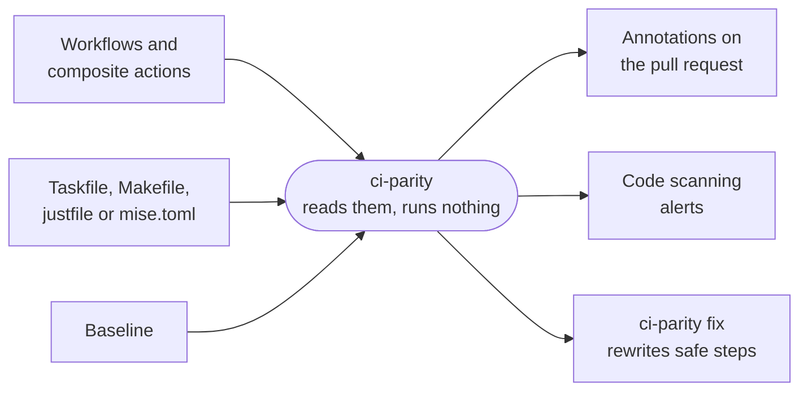

---
# Copyright (c) 2026 Jimmy Kurian. Licensed under Apache-2.0; see LICENSE.
# SPDX-License-Identifier: Apache-2.0
title: ci-parity
description: Lint GitHub Actions workflows so CI runs project commands through the task runner, with a baseline that only shrinks.
template: splash
hero:
  tagline: Check that GitHub Actions workflows run project commands through the task runner, instead of calling tools inline. A per-workflow baseline lets you adopt it today and only ever shrinks.
  image:
    light: ../../images/hero-light.svg
    dark: ../../images/hero-dark.svg
    alt: A workflow step running pnpm test is flagged P001 because the Taskfile already runs it; ci-parity fix rewrites the step to task test.
  actions:
    - text: Get started
      link: /guides/getting-started/
      icon: right-arrow
    - text: Why ci-parity
      link: /guides/why/
      variant: minimal
---

import { Card, CardGrid, LinkCard, Tabs, TabItem } from '@astrojs/starlight/components';
import Ratchet from '../../components/Ratchet.astro';

## See it in action


The same check on a workflow that calls pnpm directly, next to a Taskfile that already
wraps those commands:

```text frame="terminal" title="ci-parity check"
.github/workflows/ci.yml
  9:14    P001 inline-tool   step "Install" in job "test" runs 'pnpm install --frozen-lockfile' directly; already available as 'task install'
  11:14   P001 inline-tool   step "Test" in job "test" runs 'pnpm test' directly; already available as 'task test'
  13:19   P002 unknown-task  'task lint' is not defined in Taskfile.yml (closest: test)

3 errors, 0 warnings, 0 tolerated, 0 allowed
```

Each finding names the step, the command, and the task that already runs it.
[Getting started](/guides/getting-started/) walks through it.

## How it works



It reads the files as text: it never runs your task runner, your scripts or the network.
Every finding is on the exact line and column, in [four formats](/reference/output-formats/).

## In your pull requests

With the GitHub Action, each finding lands on its line in the pull request, and with
SARIF it shows up in code scanning too. These are from a real pull request on this
repository.

<div class="shots">
  <figure>
    <a href="/pr-annotations.png"></a>
    <figcaption>An annotation and a code scanning alert on the line that caused them</figcaption>
  </figure>
  <figure>
    <a href="/code-scanning.png"></a>
    <figcaption>The code scanning check: every new alert, with its rule</figcaption>
  </figure>
</div>

[CI setup](/guides/ci/) has both workflows.

## Works with your task runner

<Tabs syncKey="runner">
  <TabItem label="Taskfile" icon="seti:yaml">
    ```yaml title=".github/workflows/ci.yml"
    - uses: go-task/setup-task@v2
    - run: task test
    ```
    The default: no config needed. Internal tasks (`internal: true`) are reported as
    [P003](/rules/p003/).
  </TabItem>
  <TabItem label="make" icon="seti:makefile">
    ```yaml title=".github/workflows/ci.yml"
    - run: make test
    ```
    With `runner: make` in `.ci-parity.yml`. Includes are followed; `.PHONY` and pattern
    rules aren't targets.
  </TabItem>
  <TabItem label="just" icon="seti:shell">
    ```yaml title=".github/workflows/ci.yml"
    - uses: extractions/setup-just@v4
    - run: just test
    ```
    With `runner: just`. Imports and modules are followed, and `[private]` recipes are
    reported as [P003](/rules/p003/).
  </TabItem>
  <TabItem label="mise" icon="setting">
    ```yaml title=".github/workflows/ci.yml"
    - uses: jdx/mise-action@v5
    - run: mise run test
    ```
    With `runner: mise`. Tasks in `mise.toml`, includes and file tasks; `hide = true` is
    reported as [P003](/rules/p003/).
  </TabItem>
</Tabs>

[Recipes](/guides/recipes/) has a passing setup for each.

## Adopt it today, finish later

A repository with dozens of inline steps doesn't have to fix them first.
`ci-parity baseline` records each workflow's count, the check tolerates that many, and the
count can only go down.

<Ratchet />

[Adopting with a baseline](/guides/baseline/) shows each step, and
[`ci-parity fix`](/guides/fixing/) rewrites the steps it safely can.

## What it reports

<CardGrid>
  <Card title="P001 inline-tool" icon="seti:shell">
    A `run:` step calls `pnpm`, `go`, `docker` or another tool directly.
    [Fix or allow it →](/rules/p001/)
  </Card>
  <Card title="P002 unknown-task" icon="magnifier">
    CI calls a task the runner doesn't define, with the closest name.
    [Details →](/rules/p002/)
  </Card>
  <Card title="P003 internal-task" icon="close">
    CI calls an internal, private or hidden task. [Details →](/rules/p003/)
  </Card>
  <Card title="P004 regression" icon="up-arrow">
    A workflow has more inline steps than its baseline allows.
    [Details →](/rules/p004/)
  </Card>
  <Card title="P005 unsupported" icon="information">
    A step it can't analyze, such as a PowerShell step, is reported as a warning.
    [Details →](/rules/p005/)
  </Card>
  <Card title="Everything else" icon="approve-check">
    Steps that call your task runner pass. [All the rules →](/rules/)
  </Card>
</CardGrid>

## Get it

<CardGrid>
  <LinkCard title="GitHub Action" description="uses: jimmykurian/ci-parity@v1, with annotations or SARIF." href="/guides/ci/" />
  <LinkCard title="Binary, go install or mise" description="Release archives for linux, darwin and windows." href="/guides/getting-started/" />
  <LinkCard title="pre-commit hook" description="Check workflows before they're pushed." href="/guides/getting-started/#pre-commit" />
  <LinkCard title="Configure it" description="Runner, tools, and steps you mean to keep." href="/guides/configuring/" />
</CardGrid>
